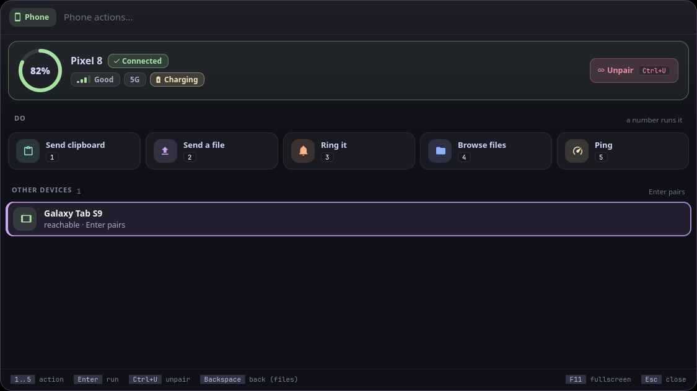

<p align="center">
  <picture>
    <source media="(prefers-color-scheme: dark)" srcset="assets/banner-dark.svg">
    <source media="(prefers-color-scheme: light)" srcset="assets/banner-light.svg">
    
  </picture>
</p>

<!-- identity -->
<p align="center">
  <b>मनोजवं मारुततुल्यवेगं जितेन्द्रियं बुद्धिमतां वरिष्ठम् ।<br>
  वातात्मजं वानरयूथमुख्यं श्रीरामदूतं शरणं प्रपद्ये ॥</b><br>
  <i>Swift as thought, fast as the wind: I turn to Rāma's messenger.</i><br>
  <sub>Rāmarakṣā Stotra 33</sub>
</p>
<!-- /identity -->

<p align="center">
  <b>Your phone through KDE Connect: battery and signal at a glance, send files and the clipboard, ring, ping, browse, pair.</b><br>
  Your phone, through KDE Connect. A tool for <a href="https://github.com/Theyashsawarkar/vyom">Vyom</a>, keyboard-driven panels for Wayland.
</p>

<p align="center">
  <a href="https://github.com/Theyashsawarkar/doot/actions/workflows/ci.yml"></a>
  <a href="https://github.com/Theyashsawarkar/doot/releases"></a>
  <a href="LICENSE"></a>
  <a href="https://github.com/Theyashsawarkar/vyom"></a>
  
  
</p>

<!-- No screenshot: phone shows personal data (your own phone). -->

<p align="center">
  
</p>
<p align="center"><sub>Screenshots use a made-up demo phone.</sub></p>

> *Doot* (दूत) is Sanskrit for "messenger": the messenger that carries files, the clipboard and pings to your phone.

doot is your phone, through KDE Connect for [Vyom](https://github.com/Theyashsawarkar/vyom): one keyboard-driven panel that opens instantly, with live data, a preview and a key for everything. It runs on any compositor with the layer-shell protocol (sway, Hyprland, river, niri, Wayfire, labwc…). In [Vayu](https://github.com/Theyashsawarkar/vayu), the desktop it was built for, it replaces phone-picker.py.

## Contents

- [Features](#features)
- [Install](#install)
- [Usage](#usage)
- [Configuration](#configuration)
- [Troubleshooting](#troubleshooting)
- [The Vyom family](#the-vyom-family)
- [Contributing](#contributing)
- [License](#license)

## Features

- **The phone at the top**: its battery as a ring, its name with a green "Connected", mobile signal as bars and a word, the network (5G, LTE…) and whether it's charging.
- **Its actions as numbered tiles**: send the clipboard, **send a recent file** (from Downloads, Pictures, Documents…), ring it to find it, browse its storage, ping it. With the search box empty, a number (`1..5 (empty search)`) runs one; typing searches them, `Enter` runs the first.
- **Unpair is red and apart**, and asks first: `Ctrl+U` once shows what it will do, a second time unpairs.
- Pairing requests at the top with Accept / Reject and the verification key; other devices below, `Enter` pairs a reachable one.
- No transfer list: KDE Connect doesn't publish its transfers' progress to other programs.
- Keyboard first: every action has a key, shown in the footer; the mouse works too.
- Never freezes the panel: slow commands run in the background.

## Install

### Requirements

- [Vyom](https://github.com/Theyashsawarkar/vyom) 0.6 or newer (Python 3.11+, PyGObject, GTK 4, [gtk4-layer-shell](https://github.com/wmww/gtk4-layer-shell), a Nerd Font)
- `kdeconnect-cli`, `busctl`
- optional: wl-paste (send clipboard)
- optional: yazi + kitty (browse)

### Install

```sh
git clone https://github.com/Theyashsawarkar/doot ~/.local/share/vyom/plugins/doot
vyom reload           # pick it up (or log out and in)
vyom doot            # open it; run it again to close
```

Give it a key in your compositor, e.g. sway:

```sh
bindsym $mod+<key> exec vyom doot
```

### Update and uninstall

```sh
git -C ~/.local/share/vyom/plugins/doot pull && vyom reload     # update
rm -rf ~/.local/share/vyom/plugins/doot && vyom reload          # uninstall
```

## Usage

Open it with `vyom doot` (or your key). Type to search; the footer always shows the keys for what's selected.

| Key | Action |
|---|---|
| `Enter` | Run the selected phone action (send, ring, browse...) |
| `Backspace (empty search)` | Go back from the file list |
| `1..5 (empty search)` | Run the phone action with that number (send clipboard, send a file, ring, browse, ping) |
| `Ctrl+U` | Remove the pairing with the phone (unpair; press twice: asks first) |
| `Esc` | Close the panel |

Every Vyom panel also has `Up`/`Down` (or `Ctrl+K`/`Ctrl+J`) to move and `Page Up`/`Page Down` to jump. Each tool opens from its own key.

## Configuration

Everything is optional, in `~/.config/vyom/config.toml` under `[plugin.doot]`:

| Setting | Default | What it does |
|---|---|---|
| `browse_command` | yazi in kitty, else xdg-open | How to open the phone's storage (`{path}` is replaced) |

Run `vyom reload` after editing.

## Troubleshooting

- **Nothing opens.** `vyom list` shows every installed tool, and why one is skipped (a missing requirement, or a Vyom that's too old).
- **It opened, then something failed.** Look for a `Traceback` in the daemon's log, `journalctl --user -u vyom -u vyom-daemon -b` (without systemd: `~/.local/state/vyom/daemon.log`), and [open an issue](https://github.com/Theyashsawarkar/doot/issues/new/choose) with it.
- **No blur or rounded corners.** That's the compositor: on SwayFX, add `layer_effects "vyom" { blur enable; corner_radius 20; shadows enable }`.

## The Vyom family

Each tool is its own repository, so you install only the ones you want:

| Tool | | What it does |
|---|---|---|
| [dvara](https://github.com/Theyashsawarkar/dvara) | द्वार, gateway | The app launcher |
| [ganit](https://github.com/Theyashsawarkar/ganit) | गणित, mathematics | The calculator and converter |
| [smriti](https://github.com/Theyashsawarkar/smriti) | स्मृति, memory | Clipboard history |
| [bhava](https://github.com/Theyashsawarkar/bhava) | भाव, feeling, emotion | The emoji picker |
| [tarang](https://github.com/Theyashsawarkar/tarang) | तरंग, wave | Wi‑Fi and the hotspot |
| [setu](https://github.com/Theyashsawarkar/setu) | सेतु, bridge | Bluetooth |
| [doot](https://github.com/Theyashsawarkar/doot) (this one) | दूत, messenger | Your phone, through KDE Connect |
| [patra](https://github.com/Theyashsawarkar/patra) | पात्र, vessel | Docker containers |
| [akashvani](https://github.com/Theyashsawarkar/akashvani) | आकाशवाणी, voice from the sky | Notifications |
| [raga](https://github.com/Theyashsawarkar/raga) | राग, melody | YouTube music and video |
| [mudra](https://github.com/Theyashsawarkar/mudra) | मुद्रा, gesture | Keybinding search |
| [urja](https://github.com/Theyashsawarkar/urja) | ऊर्जा, energy | The battery at a glance |
| [vishram](https://github.com/Theyashsawarkar/vishram) | विश्राम, rest | The power menu |
| [kendra](https://github.com/Theyashsawarkar/kendra) | केन्द्र, centre | Quick settings |

## Contributing

Bug reports, ideas and pull requests are welcome: see [CONTRIBUTING.md](CONTRIBUTING.md) for the development setup and the few rules every tool follows, and [CHANGELOG.md](CHANGELOG.md) for what changed in each release. Please report security issues privately ([SECURITY.md](SECURITY.md)).

## License

[MIT](LICENSE).
